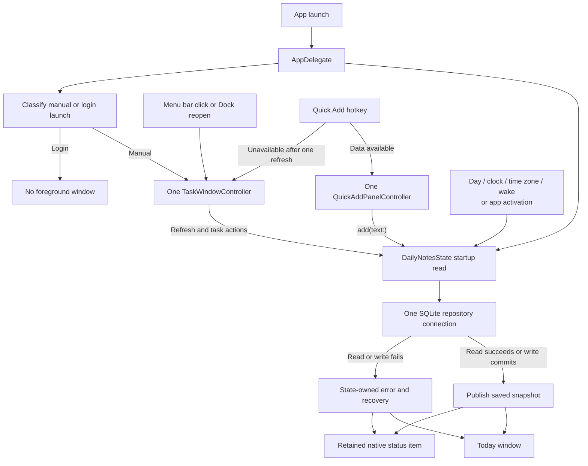

# Architecture

MenuPocket is a Swift 6 macOS application using SwiftUI for hosted views, AppKit for lifecycle/windows/the native status item, Foundation and Observation for state, and system SQLite for tasks. It has one app target and a hosted `MenuPocketTests` target in the shared scheme. Debug and Release are sandboxed regular Dock-visible applications.

## App ownership

| Owner | Responsibility |
| --- | --- |
| [MenuPocketApp](../MenuPocket/App/MenuPocketApp.swift) | Run `NSApplication` with one retained delegate. No SwiftUI scene independently creates or restores windows. |
| [AppDelegate](../MenuPocket/App/AppDelegate.swift) | Own one daily state, the retained demo/preferences model, lazy task-window controller, retained status controller, reusable Settings controller, and lazy Quick Add panel controller. Route startup, explicit presentation, Dock reopen, commands, the Quick Add hotkey, activation, and termination. Apply the saved theme app-wide. |
| [TaskWindowController](../MenuPocket/Notes/TaskWindowController.swift) | Retain one AppKit window hosting `TaskBrowserView`; refresh, restore minimization, activate, and bring it forward through `showTasks()` (retained tab, leaving History) or `showToday()` (guarded Today request). Own transient `TaskWindowPresentation` and forward settled History revisions while alive. |
| [TaskWindowView](../MenuPocket/Notes/TaskWindowView.swift) | Render the selected list's saved rows in collapsible category groups, plus Today's calendar and yesterday entries into History; bind drafts/actions to shared state, composer visibility to retained presentation, and disclosures to category preferences. Apply native focus, not saved-data ownership. `TaskBrowserView` owns the title-bar `Today | Later` control and Settings button so they stay active on History screens. |
| [TaskStatusItemController](../MenuPocket/MenuBar/TaskStatusItemController.swift) | Render the count without an icon, plus tooltip and accessibility label, from that same state. Primary click requests Today through `showToday()`. Display Today-only progress. Create no repository or saved snapshot. |
| [DailyNotesState](../MenuPocket/Notes/DailyNotesState.swift) | Own the reusable saved category catalog, daily task and undated Later snapshots, one cached repository connection, per-list drafts, scoped errors, recovery text, derived Today groups, injected category presentation preferences, and independent refresh observers. |
| [QuickAddPanelController](../MenuPocket/MenuBar/QuickAddPanelController.swift) | Retain one non-activating `QuickAddPanel` hosting a single-line field. Show, toggle, and dismiss it, and reset its text, error, and undo history each time. Save through a closure supplied by `AppDelegate`; read no daily state. |
| [SettingsWindowController](../MenuPocket/Settings/SettingsWindowController.swift) | Reuse one Settings window with the existing `AppModel` preference/login/Quick Add boundary. |

Both surfaces consume one saved-data authority. Read failures render unavailable progress; write failures preserve the last saved count. Closing the task window does not remove the status item or refresh observers.

The task window starts at 800 × 560 pt with a 600 × 400 pt minimum. Its Soft Focus header shows the date and weekday from the current day key, Add task with a Command-N hint, category/Settings icon buttons, and a compact progress/count row. The header stays outside the flexible scroll view; its date/actions can stack when needed. Content is centered with a 660 pt maximum width and 32 pt horizontal padding, reduced to 24 pt below 700 pt window width. Window geometry is presentation configuration, not a data contract.

Inside the available-data branch, the scroll view renders `DailyNotesState.groups` in order as inset surfaces with 12 pt corners, 24 pt gaps, and no decorative border or shadow. Semantic background tints distinguish the surfaces in both appearances. Each group has a header button with a disclosure chevron, the category name (wrapping when long), and that group's `progress` as `completed/total`; the existing task rows follow, indented to the name, in saved order. Rows use 14 pt text, at least 44 pt height, and wrapping without a row-wide hover background; completed rows stay muted. The ellipsis action stays visible in a secondary color and gains primary color with a small local background only while its enabled button is hovered. Native checkbox interaction and existing keyboard focus outlines remain. A collapsed group renders no rows, so their controls leave keyboard and accessibility traversal, while its header and count stay visible. Click, Space, or Return on a header calls `TaskCategoryPreferences.setCollapsed(_:for:)`; the view keeps no collapse state of its own. The empty state, unavailable state with Retry, recovery notice, and yesterday reminder stay outside the groups, and the window header keeps the overall daily progress.

Each row has an always-visible ellipsis trigger for a native Edit/Delete… menu; the checkbox and selectable text remain separate. A focusable SwiftUI button presents an AppKit `NSMenu` through a weak, non-observed view anchor. Opening takes row focus; keyboard activation waits for key release, and subsequent keys belong to the open menu. Selected actions dispatch after menu tracking finishes, allowing SwiftUI to focus the draft or Cancel without AppKit restoring the previous responder. Existing edit/deletion/category guards apply to the actions. Inline deletion confirmation remains in a conditional footer with Cancel initially focused. Add keeps its composer above the scroll view. Edit instead replaces the selected saved row with the text/category editor and its Save/Cancel controls; edit write errors appear inside that row. A pending Add draft remains in state and reappears unchanged after editing, without taking focus from the row. The active edit group cannot collapse. Stable group/row scroll targets reveal expanded editors and saved destinations; a reassignment reveals its destination group before restoring row-menu focus so lazy group rendering does not hide the result. Escape/Cancel discards only the edit, and category selection changes no saved row until Save succeeds.

`KeyboardFocusVisibility` observes app-local mouse down/up and Tab/Shift-Tab events through one monitor retained for the app lifetime. Non-text controls suppress native and custom focus decoration in mouse mode; Tab restores it without changing the saved accent color or outline weight. Ordinary typing and shortcuts preserve the current mode, so programmatic focus restoration stays visible after keyboard navigation. The monitor returns every event unchanged and never clears the first responder; editable fields keep native click-to-edit focus. Today, the category manager, Settings, and both retained panel views use this shared presentation state. Quick Add contains only an editable field and keeps its existing focus behavior.

The single Add/Edit composer sits below progress and above the scrollable list, in the same centered column. Task-write errors appear there, or beside an active inline deletion confirmation. The composer uses two rows: the task field, then a native Category picker with Save and Cancel. The picker binds directly to the visible draft's selection in state (`draftCategoryID` for a new task, `editCategoryID` for an edit), lists saved categories in creation order and then General (nil), and is disabled while data is unavailable. Its width is capped, so a long name truncates instead of crowding the actions at the minimum size. With keyboard focus, Up and Down step the selection; Return there does nothing, so choosing a category never saves. Escape still cancels through the Cancel button. Opening the composer while it is hidden and the new-task text is empty starts a genuinely new draft: `startNewDraft()` selects the last-used category while it is still saved, otherwise General. Repeated Command-N, a reopened window, or a pending draft keeps its own selection. The recovery notice shows a recovered edit's category name next to its text.

The Manage categories icon in the header, next to Add task, opens [`TaskCategoryManagerView`](../MenuPocket/Notes/TaskCategoryManagerView.swift) as a sheet attached to the Today window, so the rows and actions behind it cannot be used. It lists every saved custom category in creation order, including categories without tasks today, then General as a read-only built-in entry with no actions. Create and rename use name drafts local to the sheet, separate from task drafts, and call the state's category commands; the state's single `categoryNameIssue` is shown under the field that submitted it, and `categoryIssue` below the list. One rename is open at a time. Remove… shows a confirmation in place of the list, naming the category and its all-days task count, with Cancel focused first. Escape in a name field cancels an open rename, otherwise closes the sheet; elsewhere Escape reaches the visible Cancel or Done button. The sheet shows an unavailable state with Retry when data cannot be read. Closing it discards name drafts and returns focus to Manage categories…, or to Retry if data became unavailable.

## Daily state and persistence

History adds three read-only repository queries and no schema change. `daySummaries(in:)` returns completed/total for each day with saved tasks in an inclusive-start, exclusive-end Gregorian range, using one grouped `day_key` range query: total is `COUNT(*)`, completed is `COUNT(completed_at)`, and malformed day keys or completion values throw rather than disappearing. Counts belong to the task's assigned day, never to the completion date, and reflect currently saved rows only. Presentation fills 0/0 for loaded days without rows.

The repository also exposes `historyDaySnapshot(for:)` for read-only day detail. It validates the Gregorian day, then reads the current category catalog and the day's tasks in saved rowid order within one `BEGIN DEFERRED` transaction on the existing connection. Required reads and snapshot validation must all succeed before commit and return; failures roll back and throw. The snapshot derives whole-day progress and groups from every saved task, uses current category labels, and introduces no writes or schema change (the current repository schema is v3). History reads are exposed through the shared DailyNotesState connection. The navigation shell owns the read projections that History detail renders.

`unfinishedDayPage(before:limit:)` reads newest-first day summaries strictly before a Gregorian cutoff (initially Today), across all prior months and years. One indexed grouped query keeps whole-day completed/total counts, includes only days with unfinished tasks, and fetches at most `limit + 1` summaries. The positive limit must be below `Int.max`; the extra validated row determines whether `nextBefore` is the oldest published day. Invalid completion values also enter validation rather than disappearing as completed-only days. Failed/malformed reads throw; an empty page is a successful end of the chain. Pages use exclusive day cursors rather than OFFSET or task cursors, and do not share a snapshot across requests: consumers must reset the chain after mutations or cutoff changes. Reads preserve schema v3 and stored rows. The Unfinished projection is owned by the navigation shell and rendered by `UnfinishedTasksView`.

`Note.categoryID` defaults to nil for the built-in General group. General has no saved category UUID and its name is reserved. `TaskCategory` holds a stable UUID, trimmed display name, canonical case-folded name key, and explicit creation order. Shared name rules reject blank, multiline, and reserved names while keeping accents significant. Completion and text-copy paths preserve the association. Schema v2, category repository operations, shared category catalog/commands, category draft selection/recovery state, grouping, category presentation preferences, the grouped Today checklist, the composer's category selector, and the category manager are implemented.

`NoteRepository.categories()` returns only custom categories in creation order. `createCategory(name:)` allocates a UUID and the next integer order within a write transaction; `renameCategory(id:name:)` returns the saved category with the same identity/order. Names use the shared normalization, not SQLite's case conversion. `categoryUsageCount(id:)` counts completed and incomplete tasks across every saved day, reporting a missing category as an error rather than zero. `removeCategory(id:)` deletes the category transactionally, with the foreign key clearing every day's assignments to General while preserving all tasks, task order, timestamps, day keys, and completion/counts. Survivors are not renumbered.

Task adds/readbacks persist the optional association. `update(id:text:categoryID:)` writes text and category together; the state's edit save passes the edit draft's selected category. Every mutation commits fully or throws and rolls back, including errors raised after a fixture write has begun. Name validation throws `TaskCategoryNameError`; normalized duplicates, missing categories, malformed category rows, and integer order exhaustion throw `TaskCategoryRepositoryError`. Missing task mutations retain `SQLiteNoteStoreError.noteNotFound`; SQLite/open/schema errors retain their existing storage errors. Reads reject malformed IDs, inconsistent category names/keys, or missing task references instead of guessing General. Focused proof uses temporary SQLite databases and injected fakes, not the user's database or category interface.

[NoteDay](../MenuPocket/Notes/NoteDay.swift) derives Gregorian today/yesterday keys from one clock reading. Production calculations rebuild the calendar with the current system time zone; injected calendars remain fixed. A `Note` keeps its assigned creation-day key and absolute creation/completion instants. The repository returns tasks in saved insertion order. SQLite orders by the existing table's `rowid`, so equal timestamps or clock adjustments do not affect task positions. The state retains repository order, appends successful additions, and updates completed or edited rows in place. Deletion closes the gap without changing the remaining relative order. The visible UI says task; stored `Note` types and tables retain their names.

`DailyNotesState` owns Today and Later snapshots, drafts, and errors through one cached repository. Refresh first reads the validated global category catalog, then independently reads today's rows/yesterday's count and the undated Later rows. Each list validates its category references before publication. A Later read failure leaves valid Today progress available; a Today read failure leaves valid Later usable. A catalog/open failure makes both unavailable. `availableProgress` is Today-only; `availableLaterRemainingCount` counts unfinished Later rows. Successful empty reads produce `0/0` and `0`, respectively; unavailable reads return nil rather than fabricated empty results. Cached snapshots remain available for recovery but do not establish readiness. A changed day clears old daily rows/count before reading the new day, retaining Later edits and drafts.

State category commands use the same cached repository and require a valid catalog plus at least one available list. They can run when only Today's read fails. `createCategory(name:)` and `renameCategory(id:name:)` publish the committed category without a follow-up refresh; stable category IDs make renames visible in both sets of groups. `categoryUsageCount(id:)` includes all daily history and Later, completed rows included. `removeCategory(id:)` publishes only after storage atomically clears assignments in both tables: it updates both cached arrays, reconciles both draft contexts, removes the catalog entry, and prunes both sets of presentation preferences without deleting tasks or changing their other fields. Views must consume this state rather than open their own repository or own another saved catalog.

Today `readIssue`/`taskIssue`, Later `laterReadIssue`/`laterTaskIssue`, category-name `categoryNameIssue`, and category-command `categoryIssue` have separate boundaries and English messages. Each list's issue accessor prioritizes its load error while retaining a pending write error through Retry. Later move errors use `.move`. Ordinary failed writes keep saved rows/counts and recoverable draft text/category. Explicit storage errors for a missing Later target, a completed move source, or a missing category refresh the snapshot for recovery before reporting the failed command. Shared category removal may cancel either tab's selected edit and preserve its recovery context; it does not discard new-task text. Day changes cancel stale Today actions, not Later actions solely because the date changed.

`draftCategoryID` (new task) and `editCategoryID` (edit) are independent selections; nil is General. `beginEditing` starts from the task's saved association, and Escape/Cancel or a successful save clears only the relevant draft's text and selection, so a new draft returns to General after it saves. `addDraft()` and `saveEdit()` write text and category in one repository call, so a category-only edit is an edit. Both revalidate day, task, readiness, and the selection against the loaded catalog at save time; a failed write keeps text and selection. `add(text:categoryID:)` defaults to General, which the capture panel always uses, and returns `.unavailable` rather than writing a selection outside the catalog.

After a successful catalog read or a committed category removal, and before the catalog is replaced, the state reconciles both lists' selections. A missing new-task category becomes General with a short `refreshNotice` and keeps the text. A missing edit category cancels the edit rather than saving it as General. `recoveredEdit` keeps the unsaved text, the selected category ID, and the name it had when cancelled (nil for General), so the name survives removal; `recoveredEditDraft` is its text. Rollover and removed targets record the same context. A failed catalog read never reconciles; an independent list read failure does not hide catalog changes. A rename changes no selections because they use stable IDs.

`DailyNotesState.groups` derives Today's groups from the published catalog and rows on every read; groups and their counts are never saved. Custom categories appear in saved creation order, followed by General (`TaskGroupID.general`, which has no category row) only when today has uncategorized tasks. A category without tasks today has no group but stays in the catalog. Each group filters the canonical row array, so tasks keep saved insertion order and a reassigned task takes its original relative position. Group progress counts every row, including rows a collapsed group hides, so groups always sum to the daily progress shown in the header and menu bar.

`TaskCategoryPreferences`, injected into state, retains the existing Today keys `local.menupocket.app.taskCategories.lastUsedCategoryID` and `local.menupocket.app.taskCategories.collapsedGroupIDs`. Later uses separate `local.menupocket.app.taskCategories.later.lastUsedCategoryID` and `local.menupocket.app.taskCategories.later.collapsedGroupIDs` keys. UUID values identify custom categories; absent category means General, and collapsed-group sets also accept `general`. These keys remain outside the unchanged schema-1 `AppPreferences` envelope. Only a successful `addDraft()` or `addLaterDraft()` records its own list's last-used category. Edits, transfers, cancelled/failed saves, and Quick Add leave remembered choices unchanged. Successful adds and category reassignments expand their own destination group; a move expands the returned Note's Today group. Text-only edits do not expand groups. A validated catalog read or committed removal prunes obsolete IDs from both scopes. Missing/malformed values fall back to General or expanded groups, and unchanged values are not rewritten. Hosted tests inject isolated defaults because `UserDefaults.standard` shares the user's app sandbox.

Later command APIs are `addLaterDraft()`, `setLaterCompleted(id:completed:)`, `saveLaterEdit()`, `deleteLater(id:)`, and `moveLaterToToday(id:)`, each returning Bool. CRUD requires a valid catalog and Later snapshot without depending on Today or a displayed day. Add/edit trim text and reject empty input; edit saves text/category together and completion/edit retain insertion order and creation metadata. The Later new/edit contexts are independent of Today. If readiness refresh removes a selected new-task category, that action returns false and retains text with the General fallback; the user must explicitly retry rather than silently saving the changed selection. A missing selected edit category/target preserves `laterRecoveredEdit` context.

Move requires an unfinished Later source and valid action-day Today/Later snapshots. It takes one clock sample through `NoteDay.keys()` and, if needed, refreshes using those same keys. The repository atomically returns the committed Note; state removes its Later source and appends that returned value to Today, preserving saved identity/text/category/creation instant, expanding the Today group, and publishing `laterRefreshNotice` as "Moved task to Today." It performs no post-commit reread, so a later read failure cannot report an already-saved move as an unsaved write. Repeated/missing/completed targets do not append another row; repository collision or transaction failure leaves both lists unchanged. The menu bar continues to consume only `availableProgress`.

`TaskWindowPresentation` now retains a transient `selectedDestination`, defaulting to Today, with separate Today/Later composer visibility and destination-scoped new-task requests. New-task text, category selection and errors stay in `DailyNotesState`; switching does not copy or reset them. Any active Today/Later edit, task deletion confirmation or category sheet blocks switching. A same-destination request leaves the interaction intact. Add validation uses the selected list's readiness, so an unrelated list read failure does not disable valid commands. Opening an already-visible empty composer preserves its pending category choice rather than reapplying the remembered category.

`TaskWindowView` renders an always-visible native Today/Later segmented control through the presentation guard; it and the Settings button are toolbar items bridged into the window's unified title bar (`sceneBridgingOptions = [.toolbars]`), while the date or Later heading shares one centered row with Add task and Manage categories. Both destinations share row, composer, confirmation and inset-group geometry using private display-only values; undated Later rows are never converted into dated Notes. Bindings, saved commands, errors, collapse preferences, row identifiers and focus/scroll requests resolve against the selected list. Today retains its date/progress/yesterday surface; Later has only its heading and unfinished count, including zero-remaining populated groups and muted completed rows. Later-only empty/read-error/recovery surfaces have separate accessibility identifiers. The shared category sheet explicitly includes Later and all saved daily tasks in its removal scope.

An unfinished Later row offers Move to Today in the existing native actions menu. Success stays in Later, shows a five-second notice in the fixed interaction area (visible even after moving a bottom row in a long list), then restores focus through the scoped presentation fallback. Failure keeps the source and shows the Later write error. Selection changes invalidate delayed focus work; resizing while editing reveals the active row again. App-level menu bar, Quick Add, and native command routes are described under [Presentation and native commands](#presentation-and-native-commands).

Deletion confirmations use `TaskActionTarget`: Today carries UUID/dayKey, Later carries UUID only. Requests require the selected scope and no guarded interaction. Validation rejects a removed target or unavailable owning list; Today also rejects a changed day. Later confirmations remain valid across a date change when their data is still available. Confirmation is consumed before the correctly scoped state write, including a rejected write; retry needs a new confirmation. Focus contracts likewise resolve a target only in its owning list and use that list's collapse preferences, with surviving-group, Add and unavailable Retry fallbacks.

`TaskWindowController.showTasks()` refreshes and brings forward the same window without selecting a tab. `showToday()` also requests guarded Today selection and returns whether it was accepted; rejected selection still brings the retained window forward. Window close cancels task/category confirmations, dismisses the sheet and clears pending new-task requests, while retaining selection, composer visibility and task drafts/edits. Reopen refreshes validity; a new presentation starts on Today without storing selection in defaults. `TaskWindowView` invalidates delayed focus work on selection changes and consumes new-task requests only for the selected destination.

The Later storage/state, scoped presentation, visible tab/checklist, and native routing are implemented. The [dated presentation regression](DESKTOP_TASK_REGRESSION.md#later-tab-presentation--2026-10-05) separates hosted coverage from scoped Today-interface fixture observations; [Later regression](LATER_TASKS_REGRESSION.md) and [Later acceptance](LATER_TASKS_ACCEPTANCE.md) record the integrated automated and isolated native-fixture results.

Add, completion, edit, and deletion publish changed rows/progress only after repository success. A rejected write retains saved data/count and an add/edit draft as applicable. `add(text:)` holds the add rules (trim, reject empty, current-day key, readiness, write, append) and returns an `AddOutcome` without reading or changing the window's `draft` or `issue`; `addDraft()` delegates to it and maps the outcome onto the draft and inline error. The capture panel uses `add(text:)` directly, so its text and errors stay out of the Today window's state. Its readiness check can still run the shared day-change refresh. The [SQLite repository](../MenuPocket/Notes/SQLiteNoteRepository.swift) stores schema-version-3 tasks at Application Support `MenuPocket/notes.sqlite` within the sandbox container. Unsupported newer schemas are rejected without rewriting them. Preferences and onboarding markers remain in `UserDefaults`; the bundle identifier stays `local.menupocket.app`. The category and Later increments use the validated migrations below; no external service is introduced.

The SQLite connection enables and verifies foreign-key enforcement before transactions. Bootstrap recognizes fresh stores, known unversioned/v1/v2 layouts, and compatible v3 stores, refusing incompatible/future formats without repair/reset. Fresh stores create v3. The category migration creates `categories` and adds nullable `notes.category_id` with `ON DELETE SET NULL`; the additive v3 migration creates undated `later_tasks` with the same category relationship and its category index. Shape/integrity validation finishes before `user_version` advances, and migration commits or rolls back together. A v3 reopen validates without rewriting. Existing notes, rowids, day keys, and fields are preserved.

The app does not rewrite or vacuum the notes table. Any future rebuild or storage maintenance must explicitly preserve relative insertion order: [implicit SQLite row identifiers](https://www.sqlite.org/rowidtable.html) can change during maintenance and are not a public task identifier. Task identity remains the UUID. Older v2 binaries reject v3; binary downgrade is not supported.

State-owned calendar-day, system-clock, time-zone, and workspace-wake observers work without an open window. Startup reads before the status controller is created; activation and every explicit window presentation refresh the same state. Retry also goes through that boundary.

A changed day invalidates the old snapshot before reading the new one and never reassigns saved day keys or carries tasks forward. Existing-row actions detecting rollover refresh and reject the stale action. Day/target changes cancel editing, preserve text in `recoveredEditDraft`, and expose `refreshNotice`. New-task text and its category selection remain separate and receive the day only on explicit save.

### History read facade and invalidation

`DailyNotesState.daySummaries(in:)`, `historyDaySnapshot(for:)`, and `unfinishedDayPage(before:limit:)` delegate directly through its private cached repository. They throw failures to the caller without Today readiness or refresh, and leave Today snapshots, progress availability, scoped errors, and both drafts unchanged. Reads may open the shared connection before startup without loading Today; subsequent daily/history access reuses it. No repository handle is exposed.

The observable `historyRevision` advances after each committed daily task/category write and after each settled refresh attempt, including failed reads. A rejected write does not add a committed-data signal; a readiness refresh remains its own event. History reads, category usage reads, draft changes, and unchanged-day checks do not advance it. Browse states consume this revision and the existing lifecycle refresh signals rather than installing duplicate system observers. Termination releases the cached handle and rejects all facade reads with `HistoryReadError.terminated`; queued refresh callbacks cannot reopen storage. This seam adds no schema, saved data, preferences, or visible UI changes. Reads stay synchronous on the main actor: on a 10,950-row, three-year fixture (TASK-013), a month read took 0.24 ms, a day snapshot 0.10 ms, and an Unfinished page 0.30 ms, so no asynchronous storage or new index is warranted.

## Presentation and native commands

`TaskWindowPresentation` owns only a pending deletion ID/day, a consumed new-task request, whether the category manager is open, and a pending category removal. It does not store rows, categories, or progress. Confirmation revalidates readiness, day, and target, then consumes the request before deletion. Window close and invalidating snapshots cancel confirmation. Failed deletion keeps the saved row/count and requires a fresh confirmation.

The category manager opens over a pending new-task draft, which it leaves in state, but not during an edit, a deletion confirmation, or unavailable data. While it is open, `canAddTask` is false and deletion requests are ignored. Opening it clears old category messages. A removal request reads the all-days usage count first; a failed count shows no confirmation. The full category name scrolls independently in the fixed-size confirmation sheet, keeping the all-days notice and action buttons visible without limiting name length. Confirming consumes the request before any write, then rechecks that the category is still in the loaded catalog and that its count is unchanged. A changed count replaces the confirmation with the new count and asks again; a failed removal keeps the category and assignments and requires a fresh confirmation. A category leaving the catalog or data becoming unavailable cancels a pending removal, and so do dismissing the manager and closing the Today window, which also dismisses the manager. After a successful removal, the state's reconciliation moves a pending new-task selection to General with a notice and forgets the removed last-used category.

The view binds new/edit text to shared state. Return/Save dismisses a composer only after a successful save; Escape/Cancel discards that draft. Same-day close/reopen preserves drafts; stale edit text remains selectable for recovery and is never saved automatically. Unsaved recovery is session-only.

When an edit or deletion confirmation ends, focus returns to the row's actions trigger if the row is visible, or to its group header if collapsed. If the task disappeared, its surviving originating group is preferred, otherwise Add; unavailable data uses Retry. The view records only the action's task/group identity for this fallback, without changing saved order or category associations. Collapsing a group while one of its rows has focus moves focus to that header. The scroll view, including group headers, is disabled during deletion confirmation, so the target's group cannot be collapsed then, and while the category manager is open.

The native App/File/Edit/View/Window menus route Show Tasks, Command-N, and View > Today/Later (Command-1/Command-2) through task presentation and Command-comma through the same Settings controller. Add requests preserve existing composer text and reject active editing, deletion confirmation, an open category manager, or unavailable data. Command-N validates before bringing the window forward and uses the active destination's availability and the window presentation's `canAddTask`; without a window it targets Today. Show Tasks and Dock reopen bring the retained window forward without selecting a destination. Status-item click instead requests Today through `showToday()`, keeping Later selected while editing, deletion confirmation, or the category sheet guards the interaction. Command-1/Command-2 bring the window forward and call `selectDestination`; `canSelectDestination` disables the item that would switch away from a guarded interaction, and the selected list carries a checkmark. Both routes reuse the same controller and preserve session drafts. Edit commands use the responder chain for cut/copy/paste/select-all and text undo/redo. Saved-task undo is not implemented.

Command-W closes the active window. `applicationShouldTerminateAfterLastWindowClosed` returns false. Quit routes terminate `NSApplication`; termination removes/releases the status item, stops daily observers, releases the repository, cancels model loads, and closes owned windows. Queued refresh/observation callbacks cannot recreate those resources after termination.

The status controller uses re-armed Observation tracking of Today-only `availableProgress`, regardless of the selected tab. Its callback reads the settled snapshot on the main actor after mutation; weak captures allow release. It observes successive writes independently of window presentation.

## Launch and Settings boundaries

`AppLaunchContext` classifies login only when the launch `kAEOpenApplication` event's `keyAEPropData` enumeration equals `keyAELaunchedAsLogInItem`. The delegate reads the current launch event synchronously in `applicationDidFinishLaunching`; missing/non-login events take the manual path. The provider is injectable for hosted checks.

Manual launch shows tasks even after onboarding is complete. Login launch creates no task/Settings window and requests no activation; the regular Dock icon remains. Explicit task or Settings presentation completes unfinished onboarding only after an owned window is visible.

[LoginItemService](../MenuPocket/Services/LoginItemService.swift) wraps `SMAppService.mainApp`. Settings rereads status and handles disabled, enabled, approval-required, and unavailable states. Startup classification itself does not register or unregister login items. Fake services isolate automated checks; real registration and a stable installed copy are needed for an intended genuine-login observation.

Settings keeps its retained modeless window and controller-owned sizing. Its Startup, Appearance, Quick Add, and App sections use semantic inset surfaces inside a scroll view; warnings and errors wrap with the content, while Quit stays in a fixed footer. The category manager uses the same surface hierarchy in its attached sheet. Category-name scrolling remains separate from the all-days removal notice and actions, and restored Rename/Remove row focus scrolls into view after cancellation or a failed command. These presentation changes do not replace model/state bindings, services, or persistence.

The Settings Theme choice is the `theme` field of the schema-1 `AppPreferences` value in `UserDefaults`. `AppModel.setTheme` saves through the same commit path as other preferences, so write protection and save errors behave identically, and the reconciler carries the field through every load and save. Decoding treats a missing or unrecognized theme as System, so preferences saved by earlier builds keep every other field; earlier builds ignore the extra key. No schema version change or migration is involved.

`AppDelegate` sets `NSApplication.appearance` from the saved theme at the start of launch, before the status item or any window exists, on both manual and login launch. It follows later changes through re-armed Observation tracking until termination. System clears the override so the app follows macOS. Views use semantic system colors with small appearance-dependent overlays for inset surfaces and canvas contrast. Hosted lifecycle tests restore the process-wide appearance during cleanup.

## Quick Add boundaries

[HotKeyService](../MenuPocket/Services/HotKeyService.swift) registers one `HotKeyCombination` with a pressed handler and reports refusal as `HotKeyRegistrationError`. `CarbonHotKeyService` uses Carbon `RegisterEventHotKey` on the application event target with `kEventHotKeyExclusive`; `eventHotKeyExistsErr` maps to `alreadyInUse` and any other status to `systemError`. It needs no Accessibility or Input Monitoring permission and uses no event monitor or tap. Construction touches nothing; the first `register` installs the event handler, and a refusal leaves nothing registered. Pressed events arrive on the main thread and call the handler directly, so quick presses stay in order. There is no deinit fallback, because Carbon hotkey calls are not thread safe; the owner unregisters explicitly. A narrow `HotKeySystemAccess` boundary lets hosted tests exercise the service without claiming a real key.

`AppModel` owns the hotkey service, as it owns the login-item service, and publishes `isQuickAddRegistered` and `quickAddRegistrationFailure` for Settings. The preference is the `quickAddEnabled` field of schema-1 `AppPreferences`. It is decoded with `try?` around `decodeIfPresent`, so a missing or wrong-type value reads as off without discarding other fields, and the reconciler carries it through every load and save. `setQuickAddEnabled` saves through the shared commit path and changes registration only after a successful save. The Settings switch binds to that setter, is disabled while preference writes are protected, and shows a refusal with retry guidance. `AppDelegate` calls `startQuickAdd` after launch setup on both manual and login launch, and registration changes wait until then. A refused registration keeps the preference on; the next launch or an off/on toggle retries. `applicationWillTerminate` unregisters through `stopQuickAdd` and then closes the panel.

A hotkey press is ignored before launch finishes and during termination. Otherwise it dismisses a shown panel, or refreshes once when progress is unavailable and then shows the panel or, if data is still unavailable, a guarded Today request in the task window with Retry. Active Later editing, deletion confirmation, or category management retains Later until resolved. The panel is created on first use and reused. Quick Add always writes to Today/General through the independent `add(text:)` path; it preserves tab selection, both drafts, and both remembered category choices.

The panel is created with `.borderless` and `.nonactivatingPanel` at the floating level, with `.canJoinAllSpaces`, `.fullScreenAuxiliary`, and `.ignoresCycle`, excluded from the Windows menu, and does not hide on deactivation. It can become key but not main, so it takes typing while another app stays active. The activation policy stays `.regular`. Because the active app may own the menu bar, the panel's `performKeyEquivalent` sends cut, copy, paste, select all, undo, and redo to the field through the responder chain. It treats Command-W and Escape as dismissal and makes Command-Q, Command-N, Command-1, Command-2, and Command-comma do nothing. An input method that is composing keeps Escape. Losing key status dismisses the panel. It has its own undo manager, cleared with the text on every show and dismissal. When MenuPocket was active before the panel appeared, dismissal makes the previously key window key again.

## Retained legacy code and verification

`DailyNotesView`/`DailyNotesPanel` and the older demo panel remain in source/tests but are no longer reachable from the menu bar. Their compact-panel confirmation behavior describes a historical surface. `AppModel`, module providers, and preference stores retain earlier demo/preferences responsibilities; demo loads no longer start on app launch.

Debug hosted XCTest runs the application loop without constructing a production delegate. Fixtures supply isolated repositories, defaults, onboarding stores, launch contexts, and fake login and hotkey services, then clean up windows, the Quick Add panel, menus, status items, and observers.

[Desktop regression](DESKTOP_TASK_REGRESSION.md) records automated/build/artifact evidence. [Desktop acceptance](DESKTOP_TASK_ACCEPTANCE.md) records available system evidence and its limits. The [category handoff](TASK_CATEGORIES_HANDOFF.md) brings together category evidence and its remaining acceptance gate. [Later regression](LATER_TASKS_REGRESSION.md) and [Later acceptance](LATER_TASKS_ACCEPTANCE.md) record Today/Later evidence and its remaining production/system gaps. Injected login contexts, callback cleanup, separate fixture windows, and metadata do not by themselves prove genuine login, actual process exit, or menu bar/Dock interaction.

### History projection

`TaskHistoryState` is a main-actor observable, process-local read projection over the shared facade, with injected clock/calendar and throwing read closures for tests. It starts at yesterday and that civil month. Month summaries and day detail have separate availability, errors, dirty flags, and Retry; selecting a different date clears the old detail before reading. Reads are synchronous, so there is no suspended selection result to race a later selection. Mismatched day/month results are rejected.

Full-day progress and category groups are derived before row filters; filtering preserves the whole-day/group denominator, saved order, and current category labels. Disclosure is local to History and does not use Today defaults. Empty saved days, empty filtered results, and future months without saved rows have distinct messages. Month changes clamp the previous day number to the destination Gregorian month and select it only when past/today or containing saved future tasks. This month selects Today with All.

The retained child-screen shell forwards pane visibility and `historyRevision` to `refresh(revision:)` after existing lifecycle refreshes. Visible dirty panes reread; hidden panes remain dirty with unavailable snapshots until shown. Civil selection survives clock/time-zone changes while Today follows the injected clock. Future month selection may require month summaries even when only detail is visible. This state adds no observers, writes, or schema changes. Previous/next month steps reuse the same clamping as `changeMonth(containing:)`.

### Calendar month geometry

`HistoryMonthGrid` (in `TaskHistoryCalendar.swift`) is the pure value model behind the History month calendar. Weekdays and month lengths come from proleptic Gregorian civil-day arithmetic on `GregorianDay` and the month's exclusive end, so layout has no time zone, DST, or 86,400-second steps, and a saved dayKey keeps its cell identity when the time zone changes. Columns start on Sunday by default (`firstWeekday`, Calendar convention). Padding cells are blank and have no actions. In-month cells use `HistoryDayAvailability`: a nil month read is Unavailable (no counts), a loaded empty past/today day is 0/0, an empty future day is Not yet, and saved future rows remain readable. Today and selection are separate flags. `HistoryDayRange.day(clampedTo:)` is the month-change clamping rule shared with `TaskHistoryState`. `TaskHistoryCalendarView` renders it.

### Unfinished date index

`UnfinishedTasksState` is a main-actor observable read projection over the existing `unfinishedDayPage` facade. It starts with an exclusive Today cutoff and a configurable default page size of 31. Only date summaries are cached. A nil index means unloaded/unavailable; a successful empty page means no unfinished days. Initial and append errors are separate. Failed Load more retains published rows and its cursor; calling Load more again retries that cursor without duplicating rows.

The retained shell forwards visibility and `historyRevision` after lifecycle refreshes. Revision or clock/time-zone cutoff changes clear the chain and increment its generation; visible projections reload the first page, hidden ones wait until shown. Returned pages must match the requested cutoff/limit. Generation guards discard results/errors from reentrant older requests; production reads remain synchronous on the main actor.

Selection produces a civil day, Unfinished filter, and generation for the shared History detail state. Whole-day progress remains owned by that detail. The shell passes a successful matching day snapshot to `reconcileSelection`; old-generation detail is ignored. Selection survives a chain reset until cutoff or successful reads establish that it is no longer eligible. Absence from a partial first page alone does not imply removal; a fully traversed range or a selected-day snapshot can establish that the day no longer contains unfinished tasks. Cutoff changes have separate explanatory copy. This index adds no task writes, observers, connection, or defaults.

### Retained Today child navigation

`TaskBrowserView` hosts Today, History, and nested Unfinished within the existing task window. Today stays mounted at the same size; while hidden it cannot receive input or expose accessibility controls. Its process-local composer and native list offset survive child visits. A stable top-visible group anchor provides a first-surviving-group fallback when that group disappears. Back restores the calendar/yesterday entry (Retry when Today is unavailable); delayed focus work yields to newer Add requests.

The calendar button beside Today's date opens History. The yesterday reminder selects exactly yesterday with Unfinished, rather than opening the all-days index. Editing, deletion confirmation, and category management block both entries. New drafts can remain pending. History is reachable only from the Today tab. Show Tasks, menu bar, Dock, explicit launch, Command-N, Command-1/Command-2, and the title-bar `Today | Later` control leave History in the same window, landing on Today unless the user selects Later; Settings is retained separately. Browser selection never becomes a task-write day or the menu-bar count authority.

`TaskWindowPresentation` lazily creates History/Unfinished projections through DailyNotesState factories using its injected civil clock and private connection facade. The controller observes settled revisions even when its retained window is closed; hidden panes invalidate without rereading. Window visibility and local routes determine which projection reads. Termination stops controller observation callbacks and pane visibility before releasing storage. History renders [`TaskHistoryView`](../MenuPocket/Notes/TaskHistoryView.swift) (month controls; the month grid in [`TaskHistoryCalendarView`](../MenuPocket/Notes/TaskHistoryCalendarView.swift) renders `HistoryMonthGrid` from the state's single month read, with no per-cell reads) and [`HistoryDayDetailView`](../MenuPocket/Notes/HistoryDayDetailView.swift) (whole-day progress, filter, read-only grouped rows, pane Retry) directly from `TaskHistoryState`; neither view reads storage or defaults, and detail is reusable by Unfinished. Civil dates are formatted from their components in UTC so labels never shift with the device time zone. The browser passes its `ScrollViewProxy` through the environment so focused History controls scroll into view; disclosure resets when the selected day changes. Unfinished renders [`UnfinishedTasksView`](../MenuPocket/Notes/UnfinishedTasksView.swift) from `UnfinishedTasksState` (rows, Load more, initial/append Retry). Selecting a row uses the `unfinishedDay` route: the presentation selects the indexed day in the shared `TaskHistoryState` with the Unfinished filter, shows only the day pane, keeps the index hidden with its pages, and reconciles the index selection with each matching day snapshot after visibility/revision updates. Back to Unfinished restores row focus.
