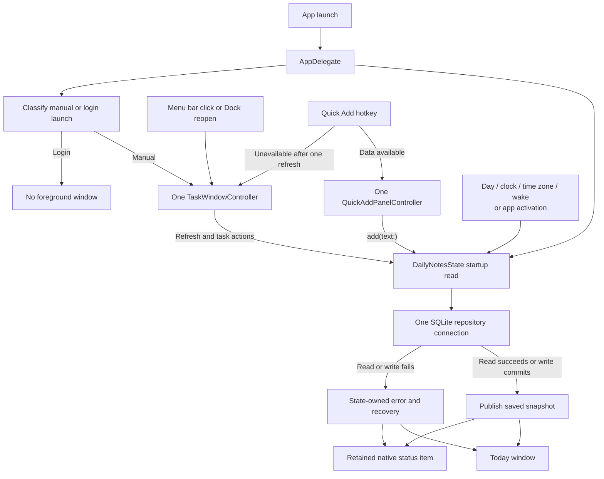

# Architecture

MenuPocket is a Swift 6 macOS application using SwiftUI for hosted views, AppKit for lifecycle/windows/the native status item, Foundation and Observation for state, and system SQLite for tasks. It has one app target and a hosted `MenuPocketTests` target in the shared scheme. Debug and Release are sandboxed regular Dock-visible applications.

## App ownership

| Owner | Responsibility |
| --- | --- |
| [MenuPocketApp](../MenuPocket/App/MenuPocketApp.swift) | Run `NSApplication` with one retained delegate. No SwiftUI scene independently creates or restores windows. |
| [AppDelegate](../MenuPocket/App/AppDelegate.swift) | Own one daily state, the retained demo/preferences model, lazy task-window controller, retained status controller, reusable Settings controller, and lazy Quick Add panel controller. Route startup, explicit presentation, Dock reopen, commands, the Quick Add hotkey, activation, and termination. Apply the saved theme app-wide. |
| [TaskWindowController](../MenuPocket/Notes/TaskWindowController.swift) | Retain one AppKit window hosting `TaskWindowView`; refresh, restore minimization, activate, and bring it forward through `showTasks()`. Own transient `TaskWindowPresentation`. |
| [TaskWindowView](../MenuPocket/Notes/TaskWindowView.swift) | Render Today and saved rows in collapsible category groups; bind drafts and actions to daily state and disclosures to its category preferences. Own composer visibility/focus, not saved data or collapse state. |
| [TaskStatusItemController](../MenuPocket/MenuBar/TaskStatusItemController.swift) | Render the count without an icon, plus tooltip and accessibility label, from that same state. Primary click calls `showTasks()`. Create no repository or saved snapshot. |
| [DailyNotesState](../MenuPocket/Notes/DailyNotesState.swift) | Own the reusable saved category catalog and daily task snapshot, one cached repository connection, drafts, scoped errors, recovery text, derived Today groups, injected category presentation preferences, and independent refresh observers. |
| [QuickAddPanelController](../MenuPocket/MenuBar/QuickAddPanelController.swift) | Retain one non-activating `QuickAddPanel` hosting a single-line field. Show, toggle, and dismiss it, and reset its text, error, and undo history each time. Save through a closure supplied by `AppDelegate`; read no daily state. |
| [SettingsWindowController](../MenuPocket/Settings/SettingsWindowController.swift) | Reuse one Settings window with the existing `AppModel` preference/login/Quick Add boundary. |

Both surfaces consume one saved-data authority. Read failures render unavailable progress; write failures preserve the last saved count. Closing the task window does not remove the status item or refresh observers.

The task window starts at 800 × 560 pt with a 600 × 400 pt minimum. The header and actions stay outside its flexible scroll view; rows wrap long text. Window geometry is presentation configuration, not a data contract.

Inside the available-data branch, the scroll view renders `DailyNotesState.groups` in order. Each group has a header button with a disclosure chevron, the category name (wrapping when long), and that group's `progress` as `completed/total`; the existing task rows follow, indented to the name, in saved order. A collapsed group renders no rows, so their controls leave keyboard and accessibility traversal, while its header and count stay visible. Click, Space, or Return on a header calls `TaskCategoryPreferences.setCollapsed(_:for:)`; the view keeps no collapse state of its own. The empty state, unavailable state with Retry, recovery notice, and yesterday reminder stay outside the groups, and the window header keeps the overall daily progress.

The composer uses two rows: the task field, then a native Category picker with Save and Cancel. The picker binds directly to the visible draft's selection in state (`draftCategoryID` for a new task, `editCategoryID` for an edit), lists saved categories in creation order and then General (nil), and is disabled while data is unavailable. Its width is capped, so a long name truncates instead of crowding the actions at the minimum size. With keyboard focus, Up and Down step the selection; Return there does nothing, so choosing a category never saves. Escape still cancels through the Cancel button. Opening the composer while it is hidden and the new-task text is empty starts a genuinely new draft: `startNewDraft()` selects the last-used category while it is still saved, otherwise General. Repeated Command-N, a reopened window, or a pending draft keeps its own selection. The recovery notice shows a recovered edit's category name next to its text.

## Daily state and persistence

`Note.categoryID` defaults to nil for the built-in General group. General has no saved category UUID and its name is reserved. `TaskCategory` holds a stable UUID, trimmed display name, canonical case-folded name key, and explicit creation order. Shared name rules reject blank, multiline, and reserved names while keeping accents significant. Completion and text-copy paths preserve the association. Schema v2, category repository operations, shared category catalog/commands, category draft selection/recovery state, grouping, category presentation preferences, the grouped Today checklist, and the composer's category selector are implemented; the category manager remains later work.

`NoteRepository.categories()` returns only custom categories in creation order. `createCategory(name:)` allocates a UUID and the next integer order within a write transaction; `renameCategory(id:name:)` returns the saved category with the same identity/order. Names use the shared normalization, not SQLite's case conversion. `categoryUsageCount(id:)` counts completed and incomplete tasks across every saved day, reporting a missing category as an error rather than zero. `removeCategory(id:)` deletes the category transactionally, with the foreign key clearing every day's assignments to General while preserving all tasks, task order, timestamps, day keys, and completion/counts. Survivors are not renumbered.

Task adds/readbacks persist the optional association. `update(id:text:categoryID:)` writes text and category together; the state's edit save passes the edit draft's selected category. Every mutation commits fully or throws and rolls back, including errors raised after a fixture write has begun. Name validation throws `TaskCategoryNameError`; normalized duplicates, missing categories, malformed category rows, and integer order exhaustion throw `TaskCategoryRepositoryError`. Missing task mutations retain `SQLiteNoteStoreError.noteNotFound`; SQLite/open/schema errors retain their existing storage errors. Reads reject malformed IDs, inconsistent category names/keys, or missing task references instead of guessing General. Focused proof uses temporary SQLite databases and injected fakes, not the user's database or category interface.

[NoteDay](../MenuPocket/Notes/NoteDay.swift) derives Gregorian today/yesterday keys from one clock reading. Production calculations rebuild the calendar with the current system time zone; injected calendars remain fixed. A `Note` keeps its assigned creation-day key and absolute creation/completion instants. The repository returns tasks in saved insertion order. SQLite orders by the existing table's `rowid`, so equal timestamps or clock adjustments do not affect task positions. The state retains repository order, appends successful additions, and updates completed or edited rows in place. Deletion closes the gap without changing the remaining relative order. The visible UI says task; stored `Note` types and tables retain their names.

`DailyNotesState` reads the ordered global category catalog, today's rows, and yesterday's unfinished count into temporary values. All three reads and validation of every nonnil task category reference must succeed before publishing the snapshot. `availableProgress` and `availableCategories` are nil before a successful load or after any required read fails; progress is rendered as `—`. A successful empty task read publishes `0/0`, even when reusable categories exist. Same-day cached categories/rows/count remain together for recovery after a failed refresh, but do not establish availability. A changed day clears old daily rows/count before any read while retaining the global catalog as unavailable cached data.

State category commands use the same cached repository. `createCategory(name:)` and `renameCategory(id:name:)` return the committed category or nil and publish the known saved value without a follow-up refresh. `removeCategory(id:)` returns success only after storage removes all-days assignments; it then clears matching associations in current-day rows and removes the catalog entry, preserving task fields, relative order, progress, and yesterday's count. `categoryUsageCount(id:)` returns an optional all-days count for future confirmation UI; a usage-read failure has its own category command error and leaves the complete daily snapshot available. Views must consume this state rather than open their own repository or own another saved catalog.

Full-snapshot `readIssue`, task-write `taskIssue`, category-name `categoryNameIssue`, and category-command `categoryIssue` have independent boundaries and English messages. Blank/multiline/reserved names and normalized duplicates are field errors; missing targets, order exhaustion, and storage failures are command errors. The existing `issue` accessor prioritizes a read error while keeping the pending task error for successful same-day Retry. Category operations never clear task errors or text drafts, except that removing the category an active edit selected cancels that edit and its error and moves its text to recovery (below). Rollover cancels stale row-action errors/edits while retaining an add draft, its category selection, and its error.

`draftCategoryID` (new task) and `editCategoryID` (edit) are independent selections; nil is General. `beginEditing` starts from the task's saved association, and Escape/Cancel or a successful save clears only the relevant draft's text and selection, so a new draft returns to General after it saves. `addDraft()` and `saveEdit()` write text and category in one repository call, so a category-only edit is an edit. Both revalidate day, task, readiness, and the selection against the loaded catalog at save time; a failed write keeps text and selection. `add(text:categoryID:)` defaults to General, which the capture panel always uses, and returns `.unavailable` rather than writing a selection outside the catalog.

After a complete snapshot read or a committed category removal, and before the catalog is replaced, the state reconciles selections. A missing new-task category becomes General with a short `refreshNotice` and keeps the text. A missing edit category cancels the edit rather than saving it as General. `recoveredEdit` keeps the unsaved text, the selected category ID, and the name it had when cancelled (nil for General), so the name survives removal; `recoveredEditDraft` is its text. Rollover and removed targets record the same context. A failed read never reconciles, and a rename changes nothing because selections use stable IDs.

`DailyNotesState.groups` derives Today's groups from the published catalog and rows on every read; groups and their counts are never saved. Custom categories appear in saved creation order, followed by General (`TaskGroupID.general`, which has no category row) only when today has uncategorized tasks. A category without tasks today has no group but stays in the catalog. Each group filters the canonical row array, so tasks keep saved insertion order and a reassigned task takes its original relative position. Group progress counts every row, including rows a collapsed group hides, so groups always sum to the daily progress shown in the header and menu bar.

`TaskCategoryPreferences`, injected into the state, stores the last-used category under `local.menupocket.app.taskCategories.lastUsedCategoryID` (a UUID string; absent means General) and collapsed groups under `local.menupocket.app.taskCategories.collapsedGroupIDs` (category UUID strings plus `general`). These keys sit beside, not inside, the schema-1 `AppPreferences` envelope, which is unchanged. Only a successful `addDraft()` records the last-used category; edits, cancelled or rejected drafts, and Quick Add's `add(text:)` do not. A successful `addDraft()`, or a `saveEdit()` that changes the category, expands the destination group so the saved task is visible; a text-only edit, a rejected save, and Quick Add change no disclosure. After a complete snapshot read or a committed removal, the state forgets IDs missing from the catalog, keeping General; a failed read prunes nothing, and unchanged values are never rewritten. Missing or malformed values read as General or expanded. Hosted tests share the app's sandbox container, where `UserDefaults.standard` holds the user's real values, so every test state with a successful read injects an isolated defaults suite.

Add, completion, edit, and deletion publish changed rows/progress only after repository success. A rejected write retains saved data/count and an add/edit draft as applicable. `add(text:)` holds the add rules (trim, reject empty, current-day key, readiness, write, append) and returns an `AddOutcome` without reading or changing the window's `draft` or `issue`; `addDraft()` delegates to it and maps the outcome onto the draft and inline error. The capture panel uses `add(text:)` directly, so its text and errors stay out of the Today window's state. Its readiness check can still run the shared day-change refresh. The [SQLite repository](../MenuPocket/Notes/SQLiteNoteRepository.swift) stores schema-version-2 tasks at Application Support `MenuPocket/notes.sqlite` within the sandbox container. Unsupported newer schemas are rejected without rewriting them. Preferences and onboarding markers remain in `UserDefaults`; the bundle identifier stays `local.menupocket.app`. The category increment adds the validated migration below; no external service is introduced.

The SQLite connection enables and verifies foreign-key enforcement before transactions. Bootstrap distinguishes fresh empty stores, the known unversioned/v1 table shape, compatible v2 stores, and incompatible/future schemas. Fresh stores create v2 directly. Legacy migration creates `categories` (UUID identity, display name, unique normalized name key, unique integer creation order), adds nullable `notes.category_id` with `ON DELETE SET NULL`, retains the day index, and adds the category index. Schema and integrity checks finish before `user_version` advances; all steps commit or roll back together. Existing rows receive null associations without being copied or rewritten. A v2 reopen validates the format/integrity without migration; incompatible stores produce a recoverable storage error rather than a repair/reset.

The app does not rewrite or vacuum the notes table. Any future table rebuild or storage maintenance must preserve relative insertion order explicitly: [implicit SQLite row identifiers](https://www.sqlite.org/rowidtable.html) can change during storage maintenance and are not a durable public task identifier. Task identity remains the saved UUID. Schema v1 binaries reject v2; binary downgrade is not supported.

State-owned calendar-day, system-clock, time-zone, and workspace-wake observers work without an open window. Startup reads before the status controller is created; activation and every explicit window presentation refresh the same state. Retry also goes through that boundary.

A changed day invalidates the old snapshot before reading the new one and never reassigns saved day keys or carries tasks forward. Existing-row actions detecting rollover refresh and reject the stale action. Day/target changes cancel editing, preserve text in `recoveredEditDraft`, and expose `refreshNotice`. New-task text and its category selection remain separate and receive the day only on explicit save.

## Presentation and native commands

`TaskWindowPresentation` owns only a pending deletion ID/day and a consumed new-task request. It does not store rows or progress. Confirmation revalidates readiness, day, and target, then consumes the request before deletion. Window close and invalidating snapshots cancel confirmation. Failed deletion keeps the saved row/count and requires a fresh confirmation.

The view binds new/edit text to shared state. Return/Save dismisses a composer only after a successful save; Escape/Cancel discards that draft. Same-day close/reopen preserves drafts; stale edit text remains selectable for recovery and is never saved automatically. Unsaved recovery is session-only.

When an edit or deletion confirmation ends, focus returns to the row's Edit button if the row is visible, to its group header if the group is collapsed, to Add if the task is gone, or to Retry if data is unavailable. Collapsing a group while one of its rows has focus moves focus to that header. The scroll view, including group headers, is disabled during deletion confirmation, so the target's group cannot be collapsed then.

The native App/File/Edit/Window menus route Show Tasks and Command-N through task presentation and Command-comma through the same Settings controller. Add requests preserve existing composer text and reject active editing, deletion confirmation, or unavailable data. Edit commands use the responder chain for cut/copy/paste/select-all and text undo/redo. Saved-task undo is not implemented.

Command-W closes the active window. `applicationShouldTerminateAfterLastWindowClosed` returns false. Quit routes terminate `NSApplication`; termination removes/releases the status item, stops daily observers, releases the repository, cancels model loads, and closes owned windows. Queued refresh/observation callbacks cannot recreate those resources after termination.

The status controller uses re-armed Observation tracking of `availableProgress`. Its callback reads the settled snapshot on the main actor after mutation; weak captures allow release. It observes successive writes independently of window presentation.

## Launch and Settings boundaries

`AppLaunchContext` classifies login only when the launch `kAEOpenApplication` event's `keyAEPropData` enumeration equals `keyAELaunchedAsLogInItem`. The delegate reads the current launch event synchronously in `applicationDidFinishLaunching`; missing/non-login events take the manual path. The provider is injectable for hosted checks.

Manual launch shows tasks even after onboarding is complete. Login launch creates no task/Settings window and requests no activation; the regular Dock icon remains. Explicit task or Settings presentation completes unfinished onboarding only after an owned window is visible.

[LoginItemService](../MenuPocket/Services/LoginItemService.swift) wraps `SMAppService.mainApp`. Settings rereads status and handles disabled, enabled, approval-required, and unavailable states. Startup classification itself does not register or unregister login items. Fake services isolate automated checks; real registration and a stable installed copy are needed for an intended genuine-login observation.

The Settings Theme choice is the `theme` field of the schema-1 `AppPreferences` value in `UserDefaults`. `AppModel.setTheme` saves through the same commit path as other preferences, so write protection and save errors behave identically, and the reconciler carries the field through every load and save. Decoding treats a missing or unrecognized theme as System, so preferences saved by earlier builds keep every other field; earlier builds ignore the extra key. No schema version change or migration is involved.

`AppDelegate` sets `NSApplication.appearance` from the saved theme at the start of launch, before the status item or any window exists, on both manual and login launch. It follows later changes through re-armed Observation tracking until termination. System clears the override so the app follows macOS. Views use semantic system colors and need no theme-specific code. Hosted lifecycle tests restore the process-wide appearance during cleanup.

## Quick Add boundaries

[HotKeyService](../MenuPocket/Services/HotKeyService.swift) registers one `HotKeyCombination` with a pressed handler and reports refusal as `HotKeyRegistrationError`. `CarbonHotKeyService` uses Carbon `RegisterEventHotKey` on the application event target with `kEventHotKeyExclusive`; `eventHotKeyExistsErr` maps to `alreadyInUse` and any other status to `systemError`. It needs no Accessibility or Input Monitoring permission and uses no event monitor or tap. Construction touches nothing; the first `register` installs the event handler, and a refusal leaves nothing registered. Pressed events arrive on the main thread and call the handler directly, so quick presses stay in order. There is no deinit fallback, because Carbon hotkey calls are not thread safe; the owner unregisters explicitly. A narrow `HotKeySystemAccess` boundary lets hosted tests exercise the service without claiming a real key.

`AppModel` owns the hotkey service, as it owns the login-item service, and publishes `isQuickAddRegistered` and `quickAddRegistrationFailure` for Settings. The preference is the `quickAddEnabled` field of schema-1 `AppPreferences`. It is decoded with `try?` around `decodeIfPresent`, so a missing or wrong-type value reads as off without discarding other fields, and the reconciler carries it through every load and save. `setQuickAddEnabled` saves through the shared commit path and changes registration only after a successful save. The Settings switch binds to that setter, is disabled while preference writes are protected, and shows a refusal with retry guidance. `AppDelegate` calls `startQuickAdd` after launch setup on both manual and login launch, and registration changes wait until then. A refused registration keeps the preference on; the next launch or an off/on toggle retries. `applicationWillTerminate` unregisters through `stopQuickAdd` and then closes the panel.

A hotkey press is ignored before launch finishes and during termination. Otherwise it dismisses a shown panel, or refreshes once when progress is unavailable and then shows the panel or, if data is still unavailable, the Today window with Retry. The panel is created on first use and reused.

The panel is created with `.borderless` and `.nonactivatingPanel` at the floating level, with `.canJoinAllSpaces`, `.fullScreenAuxiliary`, and `.ignoresCycle`, excluded from the Windows menu, and does not hide on deactivation. It can become key but not main, so it takes typing while another app stays active. The activation policy stays `.regular`. Because the active app may own the menu bar, the panel's `performKeyEquivalent` sends cut, copy, paste, select all, undo, and redo to the field through the responder chain. It treats Command-W and Escape as dismissal and makes Command-Q, Command-N, and Command-comma do nothing. An input method that is composing keeps Escape. Losing key status dismisses the panel. It has its own undo manager, cleared with the text on every show and dismissal. When MenuPocket was active before the panel appeared, dismissal makes the previously key window key again.

## Retained legacy code and verification

`DailyNotesView`/`DailyNotesPanel` and the older demo panel remain in source/tests but are no longer reachable from the menu bar. Their compact-panel confirmation behavior describes a historical surface. `AppModel`, module providers, and preference stores retain earlier demo/preferences responsibilities; demo loads no longer start on app launch.

Debug hosted XCTest runs the application loop without constructing a production delegate. Fixtures supply isolated repositories, defaults, onboarding stores, launch contexts, and fake login and hotkey services, then clean up windows, the Quick Add panel, menus, status items, and observers.

[Desktop regression](DESKTOP_TASK_REGRESSION.md) records automated/build/artifact evidence. [Desktop acceptance](DESKTOP_TASK_ACCEPTANCE.md) records available system evidence and its limits. Injected login contexts, callback cleanup, separate fixture windows, and metadata do not by themselves prove genuine login, actual process exit, or menu bar/Dock interaction.
