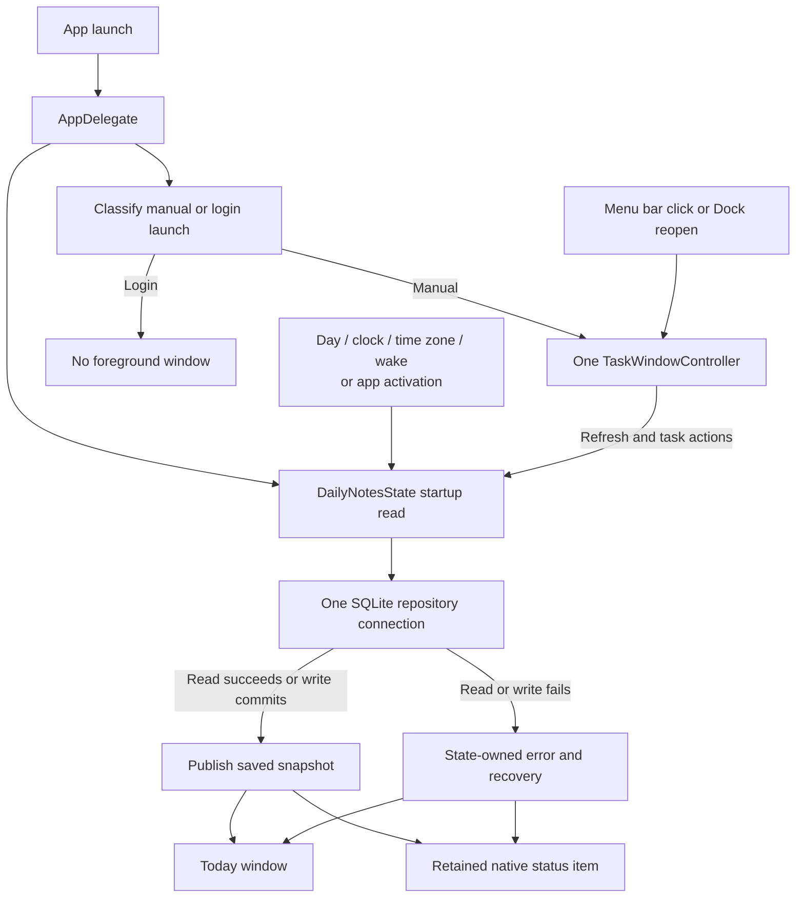

# Architecture

MenuPocket is a Swift 6 macOS application using SwiftUI for hosted views, AppKit for lifecycle/windows/the native status item, Foundation and Observation for state, and system SQLite for tasks. It has one app target and a hosted `MenuPocketTests` target in the shared scheme. Debug and Release are sandboxed regular Dock-visible applications.

## App ownership

| Owner | Responsibility |
| --- | --- |
| [MenuPocketApp](../MenuPocket/App/MenuPocketApp.swift) | Run `NSApplication` with one retained delegate. No SwiftUI scene independently creates or restores windows. |
| [AppDelegate](../MenuPocket/App/AppDelegate.swift) | Own one daily state, the retained demo/preferences model, lazy task-window controller, retained status controller, and reusable Settings controller. Route startup, explicit presentation, Dock reopen, commands, activation, and termination. |
| [TaskWindowController](../MenuPocket/Notes/TaskWindowController.swift) | Retain one AppKit window hosting `TaskWindowView`; refresh, restore minimization, activate, and bring it forward through `showTasks()`. Own transient `TaskWindowPresentation`. |
| [TaskWindowView](../MenuPocket/Notes/TaskWindowView.swift) | Render Today and saved rows; bind drafts and actions to daily state. Own composer visibility/focus, not saved data. |
| [TaskStatusItemController](../MenuPocket/MenuBar/TaskStatusItemController.swift) | Render the count without an icon, plus tooltip and accessibility label, from that same state. Primary click calls `showTasks()`. Create no repository or saved snapshot. |
| [DailyNotesState](../MenuPocket/Notes/DailyNotesState.swift) | Own saved daily data, one cached repository connection, drafts, errors, recovery text, and independent refresh observers. |
| [SettingsWindowController](../MenuPocket/Settings/SettingsWindowController.swift) | Reuse one Settings window with the existing `AppModel` preference/login boundary. |

Both surfaces consume one saved-data authority. Read failures render unavailable progress; write failures preserve the last saved count. Closing the task window does not remove the status item or refresh observers.

The task window starts at 800 × 560 pt with a 600 × 400 pt minimum. The header and actions stay outside its flexible scroll view; rows wrap long text. Window geometry is presentation configuration, not a data contract.

## Daily state and persistence

[NoteDay](../MenuPocket/Notes/NoteDay.swift) derives Gregorian today/yesterday keys from one clock reading. Production calculations rebuild the calendar with the current system time zone; injected calendars remain fixed. A `Note` keeps its assigned creation-day key and absolute creation/completion instants. The repository returns tasks in saved insertion order. SQLite orders by the existing table's `rowid`, so equal timestamps or clock adjustments do not affect task positions. The state retains repository order, appends successful additions, and updates completed or edited rows in place. Deletion closes the gap without changing the remaining relative order. The visible UI says task; stored `Note` types and tables retain their names.

`DailyNotesState` reads today's rows and yesterday's unfinished count together. Both reads must succeed before publishing the snapshot. `availableProgress` is nil before a successful load or after any failed read, rendered as `—`. A successful empty read publishes `0/0`. Same-day cached rows may remain for recovery after a failed refresh, but do not establish available progress.

Add, completion, edit, and deletion publish changed rows/progress only after repository success. A rejected write retains saved data/count and an add/edit draft as applicable. The [SQLite repository](../MenuPocket/Notes/SQLiteNoteRepository.swift) stores schema-version-1 tasks at Application Support `MenuPocket/notes.sqlite` within the sandbox container. Unsupported newer schemas are rejected without rewriting them. Preferences and onboarding markers remain in `UserDefaults`; the bundle identifier stays `local.menupocket.app`. No migration or external service is introduced.

The app does not rewrite or vacuum the notes table. Any future table rebuild or storage maintenance must preserve relative insertion order explicitly: [implicit SQLite row identifiers](https://www.sqlite.org/rowidtable.html) can change during storage maintenance and are not a durable public task identifier. Task identity remains the saved UUID.

State-owned calendar-day, system-clock, time-zone, and workspace-wake observers work without an open window. Startup reads before the status controller is created; activation and every explicit window presentation refresh the same state. Retry also goes through that boundary.

A changed day invalidates the old snapshot before reading the new one and never reassigns saved day keys or carries tasks forward. Existing-row actions detecting rollover refresh and reject the stale action. Day/target changes cancel editing, preserve text in `recoveredEditDraft`, and expose `refreshNotice`. New-task text remains separate and receives its day only on explicit save.

## Presentation and native commands

`TaskWindowPresentation` owns only a pending deletion ID/day and a consumed new-task request. It does not store rows or progress. Confirmation revalidates readiness, day, and target, then consumes the request before deletion. Window close and invalidating snapshots cancel confirmation. Failed deletion keeps the saved row/count and requires a fresh confirmation.

The view binds new/edit text to shared state. Return/Save dismisses a composer only after a successful save; Escape/Cancel discards that draft. Same-day close/reopen preserves drafts; stale edit text remains selectable for recovery and is never saved automatically. Unsaved recovery is session-only.

The native App/File/Edit/Window menus route Show Tasks and Command-N through task presentation and Command-comma through the same Settings controller. Add requests preserve existing composer text and reject active editing, deletion confirmation, or unavailable data. Edit commands use the responder chain for cut/copy/paste/select-all and text undo/redo. Saved-task undo is not implemented.

Command-W closes the active window. `applicationShouldTerminateAfterLastWindowClosed` returns false. Quit routes terminate `NSApplication`; termination removes/releases the status item, stops daily observers, releases the repository, cancels model loads, and closes owned windows. Queued refresh/observation callbacks cannot recreate those resources after termination.

The status controller uses re-armed Observation tracking of `availableProgress`. Its callback reads the settled snapshot on the main actor after mutation; weak captures allow release. It observes successive writes independently of window presentation.

## Launch and Settings boundaries

`AppLaunchContext` classifies login only when the launch `kAEOpenApplication` event's `keyAEPropData` enumeration equals `keyAELaunchedAsLogInItem`. The delegate reads the current launch event synchronously in `applicationDidFinishLaunching`; missing/non-login events take the manual path. The provider is injectable for hosted checks.

Manual launch shows tasks even after onboarding is complete. Login launch creates no task/Settings window and requests no activation; the regular Dock icon remains. Explicit task or Settings presentation completes unfinished onboarding only after an owned window is visible.

[LoginItemService](../MenuPocket/Services/LoginItemService.swift) wraps `SMAppService.mainApp`. Settings rereads status and handles disabled, enabled, approval-required, and unavailable states. Startup classification itself does not register or unregister login items. Fake services isolate automated checks; real registration and a stable installed copy are needed for an intended genuine-login observation.

## Retained legacy code and verification

`DailyNotesView`/`DailyNotesPanel` and the older demo panel remain in source/tests but are no longer reachable from the menu bar. Their compact-panel confirmation behavior describes a historical surface. `AppModel`, module providers, and preference stores retain earlier demo/preferences responsibilities; demo loads no longer start on app launch.

Debug hosted XCTest runs the application loop without constructing a production delegate. Fixtures supply isolated repositories, defaults, onboarding stores, launch contexts, and fake login services, then clean up windows, menus, status items, and observers.

[Desktop regression](DESKTOP_TASK_REGRESSION.md) records automated/build/artifact evidence. [Desktop acceptance](DESKTOP_TASK_ACCEPTANCE.md) records available system evidence and its limits. Injected login contexts, callback cleanup, separate fixture windows, and metadata do not by themselves prove genuine login, actual process exit, or menu bar/Dock interaction.
