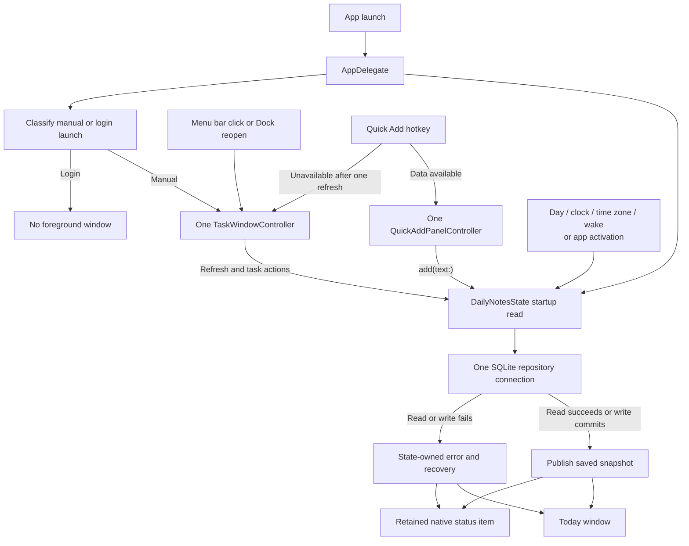

# Architecture

MenuPocket is a Swift 6 macOS application using SwiftUI for hosted views, AppKit for lifecycle/windows/the native status item, Foundation and Observation for state, and system SQLite for tasks. It has one app target and a hosted `MenuPocketTests` target in the shared scheme. Debug and Release are sandboxed regular Dock-visible applications.

## App ownership

| Owner | Responsibility |
| --- | --- |
| [MenuPocketApp](../MenuPocket/App/MenuPocketApp.swift) | Run `NSApplication` with one retained delegate. No SwiftUI scene independently creates or restores windows. |
| [AppDelegate](../MenuPocket/App/AppDelegate.swift) | Own one daily state, the retained demo/preferences model, lazy task-window controller, retained status controller, reusable Settings controller, and lazy Quick Add panel controller. Route startup, explicit presentation, Dock reopen, commands, the Quick Add hotkey, activation, and termination. Apply the saved theme app-wide. |
| [TaskWindowController](../MenuPocket/Notes/TaskWindowController.swift) | Retain one AppKit window hosting `TaskWindowView`; refresh, restore minimization, activate, and bring it forward through `showTasks()`. Own transient `TaskWindowPresentation`. |
| [TaskWindowView](../MenuPocket/Notes/TaskWindowView.swift) | Render Today and saved rows; bind drafts and actions to daily state. Own composer visibility/focus, not saved data. |
| [TaskStatusItemController](../MenuPocket/MenuBar/TaskStatusItemController.swift) | Render the count without an icon, plus tooltip and accessibility label, from that same state. Primary click calls `showTasks()`. Create no repository or saved snapshot. |
| [DailyNotesState](../MenuPocket/Notes/DailyNotesState.swift) | Own saved daily data, one cached repository connection, drafts, errors, recovery text, and independent refresh observers. |
| [QuickAddPanelController](../MenuPocket/MenuBar/QuickAddPanelController.swift) | Retain one non-activating `QuickAddPanel` hosting a single-line field. Show, toggle, and dismiss it, and reset its text, error, and undo history each time. Save through a closure supplied by `AppDelegate`; read no daily state. |
| [SettingsWindowController](../MenuPocket/Settings/SettingsWindowController.swift) | Reuse one Settings window with the existing `AppModel` preference/login/Quick Add boundary. |

Both surfaces consume one saved-data authority. Read failures render unavailable progress; write failures preserve the last saved count. Closing the task window does not remove the status item or refresh observers.

The task window starts at 800 × 560 pt with a 600 × 400 pt minimum. The header and actions stay outside its flexible scroll view; rows wrap long text. Window geometry is presentation configuration, not a data contract.

## Daily state and persistence

Category domain preparation adds an optional `Note.categoryID`, defaulting to nil for the built-in General group. General has no saved category UUID and its name is reserved. `TaskCategory` holds a stable UUID, trimmed display name, canonical case-folded name key, and explicit creation order. Shared name rules reject blank, multiline, and reserved names while keeping accents significant. Completion and text-copy paths preserve the association. Category persistence and interface controls are not implemented yet: schema version 1 still loads tasks without categories; categorized-task verification currently uses isolated in-memory fakes.

[NoteDay](../MenuPocket/Notes/NoteDay.swift) derives Gregorian today/yesterday keys from one clock reading. Production calculations rebuild the calendar with the current system time zone; injected calendars remain fixed. A `Note` keeps its assigned creation-day key and absolute creation/completion instants. The repository returns tasks in saved insertion order. SQLite orders by the existing table's `rowid`, so equal timestamps or clock adjustments do not affect task positions. The state retains repository order, appends successful additions, and updates completed or edited rows in place. Deletion closes the gap without changing the remaining relative order. The visible UI says task; stored `Note` types and tables retain their names.

`DailyNotesState` reads today's rows and yesterday's unfinished count together. Both reads must succeed before publishing the snapshot. `availableProgress` is nil before a successful load or after any failed read, rendered as `—`. A successful empty read publishes `0/0`. Same-day cached rows may remain for recovery after a failed refresh, but do not establish available progress.

Add, completion, edit, and deletion publish changed rows/progress only after repository success. A rejected write retains saved data/count and an add/edit draft as applicable. `add(text:)` holds the add rules (trim, reject empty, current-day key, readiness, write, append) and returns an `AddOutcome` without reading or changing the window's `draft` or `issue`; `addDraft()` delegates to it and maps the outcome onto the draft and inline error. The capture panel uses `add(text:)` directly, so its text and errors stay out of the Today window's state. Its readiness check can still run the shared day-change refresh. The [SQLite repository](../MenuPocket/Notes/SQLiteNoteRepository.swift) stores schema-version-1 tasks at Application Support `MenuPocket/notes.sqlite` within the sandbox container. Unsupported newer schemas are rejected without rewriting them. Preferences and onboarding markers remain in `UserDefaults`; the bundle identifier stays `local.menupocket.app`. No migration or external service is introduced.

The app does not rewrite or vacuum the notes table. Any future table rebuild or storage maintenance must preserve relative insertion order explicitly: [implicit SQLite row identifiers](https://www.sqlite.org/rowidtable.html) can change during storage maintenance and are not a durable public task identifier. Task identity remains the saved UUID.

State-owned calendar-day, system-clock, time-zone, and workspace-wake observers work without an open window. Startup reads before the status controller is created; activation and every explicit window presentation refresh the same state. Retry also goes through that boundary.

A changed day invalidates the old snapshot before reading the new one and never reassigns saved day keys or carries tasks forward. Existing-row actions detecting rollover refresh and reject the stale action. Day/target changes cancel editing, preserve text in `recoveredEditDraft`, and expose `refreshNotice`. New-task text remains separate and receives its day only on explicit save.

## Presentation and native commands

`TaskWindowPresentation` owns only a pending deletion ID/day and a consumed new-task request. It does not store rows or progress. Confirmation revalidates readiness, day, and target, then consumes the request before deletion. Window close and invalidating snapshots cancel confirmation. Failed deletion keeps the saved row/count and requires a fresh confirmation.

The view binds new/edit text to shared state. Return/Save dismisses a composer only after a successful save; Escape/Cancel discards that draft. Same-day close/reopen preserves drafts; stale edit text remains selectable for recovery and is never saved automatically. Unsaved recovery is session-only.

The native App/File/Edit/Window menus route Show Tasks and Command-N through task presentation and Command-comma through the same Settings controller. Add requests preserve existing composer text and reject active editing, deletion confirmation, or unavailable data. Edit commands use the responder chain for cut/copy/paste/select-all and text undo/redo. Saved-task undo is not implemented.

Command-W closes the active window. `applicationShouldTerminateAfterLastWindowClosed` returns false. Quit routes terminate `NSApplication`; termination removes/releases the status item, stops daily observers, releases the repository, cancels model loads, and closes owned windows. Queued refresh/observation callbacks cannot recreate those resources after termination.

The status controller uses re-armed Observation tracking of `availableProgress`. Its callback reads the settled snapshot on the main actor after mutation; weak captures allow release. It observes successive writes independently of window presentation.

## Launch and Settings boundaries

`AppLaunchContext` classifies login only when the launch `kAEOpenApplication` event's `keyAEPropData` enumeration equals `keyAELaunchedAsLogInItem`. The delegate reads the current launch event synchronously in `applicationDidFinishLaunching`; missing/non-login events take the manual path. The provider is injectable for hosted checks.

Manual launch shows tasks even after onboarding is complete. Login launch creates no task/Settings window and requests no activation; the regular Dock icon remains. Explicit task or Settings presentation completes unfinished onboarding only after an owned window is visible.

[LoginItemService](../MenuPocket/Services/LoginItemService.swift) wraps `SMAppService.mainApp`. Settings rereads status and handles disabled, enabled, approval-required, and unavailable states. Startup classification itself does not register or unregister login items. Fake services isolate automated checks; real registration and a stable installed copy are needed for an intended genuine-login observation.

The Settings Theme choice is the `theme` field of the schema-1 `AppPreferences` value in `UserDefaults`. `AppModel.setTheme` saves through the same commit path as other preferences, so write protection and save errors behave identically, and the reconciler carries the field through every load and save. Decoding treats a missing or unrecognized theme as System, so preferences saved by earlier builds keep every other field; earlier builds ignore the extra key. No schema version change or migration is involved.

`AppDelegate` sets `NSApplication.appearance` from the saved theme at the start of launch, before the status item or any window exists, on both manual and login launch. It follows later changes through re-armed Observation tracking until termination. System clears the override so the app follows macOS. Views use semantic system colors and need no theme-specific code. Hosted lifecycle tests restore the process-wide appearance during cleanup.

## Quick Add boundaries

[HotKeyService](../MenuPocket/Services/HotKeyService.swift) registers one `HotKeyCombination` with a pressed handler and reports refusal as `HotKeyRegistrationError`. `CarbonHotKeyService` uses Carbon `RegisterEventHotKey` on the application event target with `kEventHotKeyExclusive`; `eventHotKeyExistsErr` maps to `alreadyInUse` and any other status to `systemError`. It needs no Accessibility or Input Monitoring permission and uses no event monitor or tap. Construction touches nothing; the first `register` installs the event handler, and a refusal leaves nothing registered. Pressed events arrive on the main thread and call the handler directly, so quick presses stay in order. There is no deinit fallback, because Carbon hotkey calls are not thread safe; the owner unregisters explicitly. A narrow `HotKeySystemAccess` boundary lets hosted tests exercise the service without claiming a real key.

`AppModel` owns the hotkey service, as it owns the login-item service, and publishes `isQuickAddRegistered` and `quickAddRegistrationFailure` for Settings. The preference is the `quickAddEnabled` field of schema-1 `AppPreferences`. It is decoded with `try?` around `decodeIfPresent`, so a missing or wrong-type value reads as off without discarding other fields, and the reconciler carries it through every load and save. `setQuickAddEnabled` saves through the shared commit path and changes registration only after a successful save. The Settings switch binds to that setter, is disabled while preference writes are protected, and shows a refusal with retry guidance. `AppDelegate` calls `startQuickAdd` after launch setup on both manual and login launch, and registration changes wait until then. A refused registration keeps the preference on; the next launch or an off/on toggle retries. `applicationWillTerminate` unregisters through `stopQuickAdd` and then closes the panel.

A hotkey press is ignored before launch finishes and during termination. Otherwise it dismisses a shown panel, or refreshes once when progress is unavailable and then shows the panel or, if data is still unavailable, the Today window with Retry. The panel is created on first use and reused.

The panel is created with `.borderless` and `.nonactivatingPanel` at the floating level, with `.canJoinAllSpaces`, `.fullScreenAuxiliary`, and `.ignoresCycle`, excluded from the Windows menu, and does not hide on deactivation. It can become key but not main, so it takes typing while another app stays active. The activation policy stays `.regular`. Because the active app may own the menu bar, the panel's `performKeyEquivalent` sends cut, copy, paste, select all, undo, and redo to the field through the responder chain. It treats Command-W and Escape as dismissal and makes Command-Q, Command-N, and Command-comma do nothing. An input method that is composing keeps Escape. Losing key status dismisses the panel. It has its own undo manager, cleared with the text on every show and dismissal. When MenuPocket was active before the panel appeared, dismissal makes the previously key window key again.

## Retained legacy code and verification

`DailyNotesView`/`DailyNotesPanel` and the older demo panel remain in source/tests but are no longer reachable from the menu bar. Their compact-panel confirmation behavior describes a historical surface. `AppModel`, module providers, and preference stores retain earlier demo/preferences responsibilities; demo loads no longer start on app launch.

Debug hosted XCTest runs the application loop without constructing a production delegate. Fixtures supply isolated repositories, defaults, onboarding stores, launch contexts, and fake login and hotkey services, then clean up windows, the Quick Add panel, menus, status items, and observers.

[Desktop regression](DESKTOP_TASK_REGRESSION.md) records automated/build/artifact evidence. [Desktop acceptance](DESKTOP_TASK_ACCEPTANCE.md) records available system evidence and its limits. Injected login contexts, callback cleanup, separate fixture windows, and metadata do not by themselves prove genuine login, actual process exit, or menu bar/Dock interaction.
